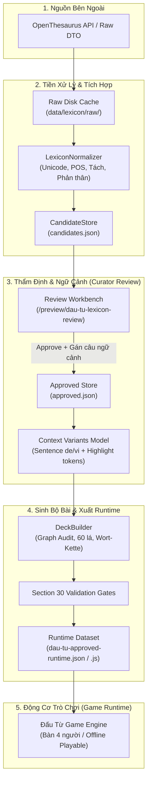

# VOKABELGO — ĐẤU TỪ: KIẾN TRÚC LEXICAL PIPELINE v0.1

Tài liệu kỹ thuật đặc tả toàn bộ quy trình tích hợp từ điển mở rộng (bắt đầu từ **OpenThesaurus**), chuẩn hóa ngữ pháp tiếng Đức, thẩm định ngữ cảnh ngữ nghĩa (Sense/Context Review), sinh bộ bài 60 lá (Deck Builder) và xuất dữ liệu chạy game (Game Runtime).

---

## 1. NGUYÊN TẮC CỐT LÕI & CÁCH LY RUNTIME (SECTION 1, 43)

Trò chơi bài **Đấu Từ** trong VokabelGo áp dụng nguyên lý:
> **Tuyệt đối KHÔNG gọi API từ điển ngoài khi người chơi đang đánh bài.**

Game runtime là một hệ thống **100% Offline-Playable**, hoàn toàn tự chủ, chỉ nạp dữ liệu đã qua quy trình kiểm định chất lượng nghiêm ngặt (**APPROVED DATASET**). Mọi truy vấn từ điển ngoài chỉ diễn ra ở giai đoạn **Tiền xử lý (Offline Pre-processing / Ingestion)**.

---

## 2. CÁC GIAI ĐOẠN CHI TIẾT (STAGES)

### Giai đoạn 1: Nạp Dữ liệu & Bộ đệm (Ingestion & Raw Disk Cache)
- **Adapter**: `OpenThesaurusAdapter` kết nối đến endpoint công khai `https://api.openthesaurus.de/synonyme/search`.
- **Cơ chế Cache**: Mọi phản hồi JSON từ OpenThesaurus được lưu thành file tĩnh tại `data/lexicon/raw/openthesaurus/<lemma>.json`.
- **An toàn mạng**: Nếu không có internet hoặc trong môi trường sandbox, adapter tự động đọc từ kho cache 70 từ vựng đã seed sẵn mà không làm gãy pipeline.
- **Bản quyền**: Tuân thủ giấy phép **Creative Commons Attribution-ShareAlike 4.0 (CC-BY-SA 4.0)** và **GNU Lesser General Public License (LGPL)**.

### Giai đoạn 2: Chuẩn hóa Ngữ pháp & Bảo toàn Unicode (Section 36)
`LexiconNormalizer` chịu trách nhiệm làm sạch dữ liệu:
- **Bảo toàn Unicode tiếng Đức**: Tuyệt đối **không** chuyển `ß → ss`, **không** strip dấu umlaut `ä, ö, ü`. Canonical lemma và canonical entry ID giữ nguyên ký tự gốc (ví dụ: `verb_schließen_close`, `verb_aufhören_stop`, `adj_groß_large`).
- **Phát hiện tiền tố động từ tách (Trennbare Verben)**: Tự động nhận diện các tiền tố `ab-`, `an-`, `auf-`, `aus-`, `ein-`, `mit-`, `zu-`, `zurück-`... (ví dụ: `anfangen` -> separable=true, prefix='an').
- **Phát hiện động từ phản thân (Reflexive Verben)**: Nhận biết cụm `sich ...` (ví dụ: `sich beeilen` -> reflexive=true).
- **Phân tách Đa nghĩa (Polysemy Separation - Section 48)**: Ngăn chặn gộp nghĩa bừa bãi. Ví dụ: từ `schwer` được tách thành 2 entry độc lập:
  - `adj_schwer_difficult` (nghĩa khó, trừu tượng)
  - `adj_schwer_heavy` (nghĩa nặng, vật lý)

### Giai đoạn 3: Thẩm định Ngữ cảnh (Sense & Context Review)
- Mỗi quan hệ đồng nghĩa được lưu vào `CandidateStore` kèm điểm tin cậy `confidenceScore`, nhãn văn phong (register) và nhật ký thẩm định (`reviewedBy`, `updatedAt`, `reviewNotes`).
- Để một quan hệ chuyển sang trạng thái `approved`, bắt buộc phải có một **Approved Context** đi kèm:
  - Định danh ngữ cảnh: `ctx_<pos>_<meaning>`
  - Chủ đề bài học: `topic`
  - Tối thiểu 2 biến thể câu ví dụ hoàn chỉnh (`variants`): câu tiếng Đức (`de`), từ/cụm từ chia được highlight trong câu (`highlightTokens`), và nghĩa tiếng Việt (`vi`).
  - Cặp trái nghĩa **GEGENTEIL** hợp lệ 2 chiều (Bidirectional antonym).

### Giai đoạn 4: Sinh Bộ Bài (Deck Builder & Graph Connectivity)
`DeckBuilder` tổng hợp bộ bài chuẩn 60 lá vật lý:
- **48 lá từ vựng**: 12 entry đã duyệt × 4 màu cơ bản (`rot`, `blau`, `gruen`, `gelb`).
- **12 lá chức năng**:
  - 4 lá `Aussetzen` (1 lá cho mỗi màu: Đỏ, Xanh dương, Xanh lá, Vàng).
  - 4 lá `Zieh Zwei` (+2) (1 lá cho mỗi màu).
  - 2 lá `Farbenwahl` (Lá đổi màu trung tính).
  - 2 lá `GEGENTEIL!` (Lá đảo nghĩa trung tính).
- **Kiểm định Topo Đồ thị**:
  - Không có đỉnh cô lập (`isolatedNodesCount === 0`).
  - Hệ số khả thi Wort-Kette đạt loại **A+** (100% chuỗi xích từ vựng đều có đường liên thông hợp lệ).

### Giai đoạn 5: Cửa Kiểm định Nghiêm ngặt (Section 30 Validation Gates)
`RuntimeExporter` kiểm tra toàn bộ dữ liệu trước khi xuất file. Nếu phát hiện bất kỳ lỗi nào sau đây, pipeline sẽ **Hard Fail** ngay lập tức:
1. Rò rỉ quan hệ chưa duyệt (`candidate`, `rejected`, `needs_review`) vào runtime dataset.
2. Cạnh ngữ nghĩa trỏ đến `entryId` không tồn tại trong danh sách entry đã duyệt.
3. Cạnh đồng nghĩa thiếu ngữ cảnh (`contextScope`).
4. Ngữ cảnh có dưới 2 biến thể câu ví dụ.
5. Token highlight không xuất hiện chính xác trong câu ví dụ tiếng Đức.
6. Từ loại (POS) không hợp lệ.
7. Cặp trái nghĩa GEGENTEIL trỏ đến mục từ hoặc ngữ cảnh không tồn tại.

---

## 3. CẤU TRÚC FILE RUNTIME ĐƯỢC XUẤT

Pipeline xuất ra 2 định dạng tại thư mục `data/lexicon/runtime/`:
1. `dau-tu-approved-runtime.json`: JSON tĩnh phục vụ kiểm thử tự động, công cụ phân tích và backend dev server.
2. `dau-tu-runtime-data.js`: UMD module cho trình duyệt web, tự động gán vào biến toàn cục `window.DAU_TU_EXPANDED_RUNTIME`.

---

## 4. TÍCH HỢP BÀN CHƠI 4 NGƯỜI (GAME RUNTIME)

Tại giao diện `dau-tu.html`:
- Người chơi có thể bấm chọn **"Kho từ Mở rộng (Expanded Lexicon)"** trực tiếp trên màn hình thiết lập.
- Khi ván đấu bắt đầu, `dau-tu-engine.js` nạp bộ bài 60 lá từ `DAU_TU_DATA.LEXICON_EXPANDED`, chia 5 lá cho người chơi và 3 bot (Max, Lena, Mia), mở 1 lá bài từ vựng đầu tiên lên bàn đấu, đảm bảo bảo toàn chính xác 60 lá bài xuyên suốt ván chơi.
