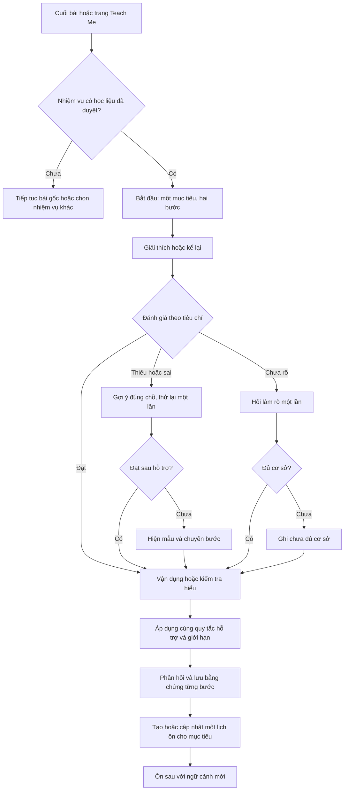

# Teach Me v0.1 — Dạy Zehn để hiểu và dùng được

Ngày: 22/10/2026. Trạng thái: đề xuất sản phẩm và workflow để review, chưa tích hợp vào web. Các thời lượng, lịch ôn và giới hạn lượt dưới đây là giả thuyết cho bản thử nghiệm.

## 1. Quyết định sản phẩm

Teach Me là lớp luyện tập dùng chung: nhận nội dung từ một hoạt động học, giao một nhiệm vụ vừa sức, phản hồi theo bằng chứng và đưa phần cần luyện vào lần ôn sau. Học viên có thể mở từ cuối bài hoặc từ trang Teach Me.

- Mỗi lượt tập trung một mục tiêu. Hai bước bắt buộc: giải thích/kể lại, sau đó vận dụng hoặc trả lời câu hỏi kiểm tra hiểu.
- Mặc định khoảng 3 phút; có thể kết thúc, bỏ qua hoặc để sau bất kỳ lúc nào. Thời lượng là ước tính, không đếm ngược hay tự nộp.
- Chọn nhóm A2 để thử trước. Nhãn A2 của học liệu mẫu cần được người phụ trách học thuật duyệt.
- Bản đầu dùng gõ văn bản. Thiết kế có chỗ thêm thu âm, nhưng nhận dạng giọng nói và chấm phát âm là phạm vi riêng.
- Chỉ hiển thị lời mời ở điểm kết thúc có ý nghĩa; không tự mở sau từng thẻ từ và không bắt buộc để hoàn thành bài gốc.
- Bản đầu có 10 nhiệm vụ mẫu chờ duyệt: 5 nhiệm vụ đọc hiểu, 5 nhiệm vụ giải thích ngữ pháp. Cùng một bộ máy hội thoại và một bộ quy tắc ghi nhận kết quả.
- Thư viện sách song ngữ và trang ngữ pháp là điểm vào dự kiến. Thư viện hiện thấy trong index.html là thư viện flashcard/bộ sưu tập; không mặc định đó đã là thư viện sách.

## 2. Khắc phục nhược điểm

| Nhược điểm | Thiết kế v0.1 |
|---|---|
| Tốn thời gian, cảm giác có thêm bài tập | Hai bước chính, mỗi bước tối đa hai câu trả lời học thuật; cho phép để sau và thoát có lưu |
| Khó vì chưa đủ tiếng Đức | Cho giải thích bằng tiếng Việt; phần vận dụng hỗ trợ từ khóa và đầu câu |
| Lẫn hiểu nội dung với năng lực diễn đạt | Ghi kết quả nội dung và tiếng Đức riêng, chỉ đánh giá các tiêu chí thuộc mục tiêu |
| AI sửa sai hoặc khen chung chung | Chấm theo rubric và học liệu đã duyệt; phản hồi trích đúng phần học viên đã viết; có trạng thái chưa đủ cơ sở |
| Zehn vừa giả vờ không biết vừa làm giám khảo | Zehn là bạn học tò mò; phần nhận xét đặt trong thẻ “Điều em vừa làm được”; v0.1 không dùng hiểu sai có chủ đích |
| Nhàm chán | Hai mẫu nhiệm vụ; thay ngữ cảnh giữa lần học và lần ôn, không lặp nguyên câu hỏi |
| Vừa học xong đã bị coi là nhớ lâu | Tách hoàn thành buổi học, kết quả từng bước và bằng chứng ở lần ôn sau |
| Chi phí, vận hành lớn | Học liệu và gợi ý chuẩn bị trước, giới hạn bước; không dùng hội thoại mở hoặc voice realtime trong v0.1 |

## 3. Hai mẫu nhiệm vụ

### A. Kể Zehn nghe — từ bài đọc

- Mục tiêu ví dụ: hiểu và kể lại hai ý chính của một đoạn ngắn.
- Bước 1: kể lại 2–3 câu. Chấp nhận nhiều cách diễn đạt và tiếng Việt khi cần; ghi rõ ngôn ngữ đã dùng.
- Bước 2: một câu hỏi “vì sao” hoặc suy luận đơn giản có căn cứ trong bài, chỉ khi bài có đủ dữ kiện.
- Không tự thêm yêu cầu dùng một cấu trúc ngữ pháp nếu nhiệm vụ đang đánh giá đọc hiểu.
- Lỗi ngôn ngữ ngoài mục tiêu không làm mất kết quả hiểu bài. Chỉ góp ý một lỗi làm sai nghĩa khi cần.

### B. Giải thích và dùng thử — từ ngữ pháp hoặc đoạn đọc có cấu trúc phù hợp

- Mục tiêu ví dụ: dùng weil để diễn đạt lý do, với động từ chia ở cuối mệnh đề phụ.
- Bước 1: giải thích ngắn cách dùng hoặc chỉ ra cấu trúc qua một ví dụ; có thể dùng tiếng Việt.
- Bước 2: tự tạo một câu trong tình huống mới bằng tiếng Đức.
- Nếu mở từ thư viện, nhiệm vụ phải có sẵn mục tiêu và học liệu hỗ trợ; không buộc mọi bài đọc thành bài ngữ pháp.

## 4. Điểm vào và màn hình

1. Cuối bài: thẻ “Dạy Zehn · khoảng 3 phút” và “Để sau”. Bấm để sau lưu một nhiệm vụ chờ duy nhất, không coi là học thất bại.
2. Trang Teach Me: ưu tiên nhiệm vụ đến hạn, rồi bài vừa học, rồi chọn chủ đề. Chỉ gợi ý một nhiệm vụ chính tại một thời điểm.
3. Màn nhiệm vụ: tên bài, mục tiêu, bước 1/2 hoặc 2/2, lời Zehn và ô trả lời. Các nút phụ: Gợi ý, Xem bài, Để sau. Không cần màn chọn cấu hình dài.
4. Thẻ kết quả: điều làm được, mức hỗ trợ, một điểm cần luyện, thời điểm ôn dự kiến; nút Trở lại bài và Về trang học.
5. Lần ôn: một nhiệm vụ mới cho cùng mục tiêu, khoảng 1 phút; không bắt đọc lại toàn bộ tài nguyên.

“Để sau” trước khi bắt đầu tạo hàng chờ. Trong buổi học, nó lưu bản nháp. Mở lại giữ lượt đã trả lời và hỗ trợ đã sử dụng; không khởi tạo kết quả tự làm từ đầu.

## 5. Sơ đồ chính

Sơ đồ rút gọn: ở nhánh làm rõ, câu trả lời được đánh giá lại bằng cùng tiêu chí. Nếu đã rõ và còn sai, hiện gợi ý/mẫu phù hợp rồi chuyển bước vì đã hết hai câu trả lời. Không tự coi “đã đủ cơ sở” là “đã đạt”.

## 6. Quy tắc xử lý câu trả lời

- Mỗi bước có tối đa hai câu trả lời học thuật được gửi: lần đầu và một lần thử lại/làm rõ. Gợi ý không làm tăng giới hạn đó. Toàn buổi tối đa bốn câu trả lời học thuật, ngoài thao tác giao diện.
- Đánh giá ý nghĩa theo rubric; không so khớp duy nhất một câu mẫu. Câu đúng ngoài các ví dụ được chấp nhận nếu có thể kiểm chứng; nếu không, ghi chưa đủ cơ sở.
- Nếu đúng: nhận xét một câu có căn cứ, rồi chuyển bước.
- Nếu thiếu: chỉ hỏi phần thiếu. Câu hỏi này dùng lượt trả lời còn lại.
- Nếu sai: nêu một điểm trọng tâm, đưa từ khóa hoặc đầu câu, cho thử lại một lần. Sau đó nếu vẫn sai thì hiện mẫu đã duyệt và chuyển bước.
- Nếu không rõ: hỏi làm rõ một lần, không tự gán là sai. Sau lần thứ hai vẫn không đủ cơ sở thì ghi unknown.
- Nút Gợi ý: bậc 1 là từ khóa, bậc 2 là đầu câu. Xem mẫu là mức hỗ trợ cao nhất. Tất cả được ghi vào lịch sử.
- Xem lại bài trong buổi luyện được ghi là có tham khảo. Việc đọc bài ở bước học trước buổi Teach Me là bình thường, không tự gán thành có hỗ trợ trong buổi.
- Nếu ngữ cảnh hiện tại đã chứa đáp án hoặc câu mẫu đủ để sao lại, ghi nhận hỗ trợ dù học viên không bấm nút. Bước vận dụng sau một gợi ý liên quan được ghi là vận dụng sau hỗ trợ.
- Học viên chủ động bỏ qua một bước: ghi skipped, không coi là sai và không coi là đạt.
- Câu mẫu hoặc sửa lỗi được hiển thị trước khi kết thúc để học viên không rời buổi với hiểu lầm chưa được xử lý.

## 7. Một buổi học mẫu đầy đủ

Nguồn minh họa mới, chưa là học liệu đã duyệt: “Lena fährt mit dem Bus, weil es regnet.” Mục tiêu: dùng weil để diễn đạt lý do. Nhiệm vụ có thể mở từ một bài ngữ pháp hoặc đoạn đọc phù hợp.

**Bước 1 — giải thích**

Zehn: “Zehn gặp từ weil trong câu này. Bạn giải thích theo cách bạn hiểu nhé. Khi nào mình dùng weil?”

Học viên: “Mình dùng weil để nói lý do, giống như vì.”

Zehn: “À, weil giúp mình nói vì sao một việc xảy ra. Zehn nối được hai ý trong câu về Lena rồi.”

**Bước 2 — vận dụng**

Zehn: “Vậy là weil giúp mình nói lý do. Bạn ở nhà vì trời lạnh. Bạn sẽ nói thế nào với weil?”

Học viên: “Ich bleibe zu Hause, weil es ist kalt.”

Zehn: “Zehn hiểu ý bạn muốn ở nhà vì lạnh. Mình cùng nhìn lại phần sau weil nhé. Bạn thử viết lại câu, đổi vị trí của ist trong phần sau weil nhé?”

Học viên: “Ich bleibe zu Hause, weil es kalt ist.”

**Kết quả**

- Hiểu cách dùng: trả lời được trong lượt giải thích, bằng tiếng Việt và có ví dụ nguồn trong ngữ cảnh.
- Vận dụng tiếng Đức: làm được sau một câu hỏi dẫn dắt về vị trí động từ.
- Cần luyện: tự đặt câu mới với weil ở lần ôn sau.
- Hoàn thành buổi học; không suy ra đã thành thạo hoặc ghi một lần nhớ đúng cho các thẻ từ trong câu.

**Nếu trả lời sai cả hai lần ở bước 2:** hiện câu mẫu đúng, ghi “đã xem mẫu — cần luyện thêm”, vẫn cho kết thúc buổi. Nếu học viên muốn tập tiếp, tạo lượt luyện có hỗ trợ riêng; không ghi đè bằng chứng ban đầu.

**Nếu trả lời “Ich bleibe zu Hause, weil es draußen kalt ist.”:** chấp nhận vì đúng ý và cấu trúc, dù khác câu mẫu.

**Nếu dùng tiếng Việt ở bước 2:** ghi hiểu lý do nếu có bằng chứng; kỹ năng dùng weil bằng tiếng Đức là chưa có bằng chứng. Đưa đầu câu tiếng Đức và cho thử trong lượt còn lại.

## 8. Quy tắc kết quả và lịch ôn

Ba lớp thông tin tách biệt:

1. Trạng thái buổi: started / paused / completed / exited. Completed là đã đi qua hai bước tới kết quả, không có nghĩa đạt cả hai bước. Bước bị bỏ qua vẫn hiện rõ.
2. Kết quả mỗi tiêu chí: met / partial / not_yet / unknown / skipped. Kèm bằng chứng, ngôn ngữ và mức hỗ trợ: none / keywords / sentence_starter / followup_question / rule_hint / source / model. Câu hỏi dẫn dắt chưa cung cấp đáp án được tách khỏi gợi ý đã nêu quy tắc.

Cập nhật dẫn dắt v0.2: mỗi lần hỏi một điều. Bước giải thích weil chỉ đòi làm rõ công dụng nêu lý do; vị trí động từ được quan sát ở bước vận dụng. Chi tiết giọng Zehn nằm trong demo/GIONG-NOI-MAY.txt. Không yêu cầu thêm một tiêu chí chưa được hỏi ở bước đầu.
3. Bằng chứng theo thời gian: lượt luyện ban đầu, có hỗ trợ, tự làm ở ngữ cảnh mới và kết quả ôn sau. Một lượt completed không tạo nhãn thành thạo.

Lịch thử nghiệm, được hệ thống quyết định thay vì AI tự viết ngày:

- Cần hỗ trợ hoặc chưa đạt: đề xuất ôn ngày hôm sau.
- Tự làm đạt ở cả hai bước, không có đáp án sẵn trong ngữ cảnh: đề xuất ôn sau 3 ngày.
- Lần ôn sau tự làm đạt trong ngữ cảnh mới: đề xuất lần tiếp sau 7 ngày.
- Unknown do chấm không chắc hoặc lỗi dịch vụ: giữ nguyên lịch cũ nếu có; nếu chưa có, mời thử một nhiệm vụ khác, không tạo lịch như thể học sai.
- Skipped ở tiêu chí bắt buộc: giữ nhiệm vụ chờ luyện, không nâng mức; học viên có thể để sau.
- Chỉ một mục ôn đang chờ cho một người học + mục tiêu + phiên bản rubric. Luyện nhiều lần không tạo hàng loạt bản sao.
- Ngày trên giao diện dùng múi giờ người học; người dùng hiện tại là Asia/Saigon. Các khoảng 1/3/7 ngày chỉ là điểm xuất phát để thử, không là lịch tối ưu đã được chứng minh cho sản phẩm.

## 9. Hợp đồng nội dung và AI

Mỗi nhiệm vụ cần có trước khi mở cho học viên:

- task_id, task_version, source_id, source_version, source_type, return_location.
- learner_level, template, objective_id, objective_description, output_language_policy.
- Nội dung nguồn, bằng chứng tham chiếu, các tiêu chí bắt buộc và ví dụ hợp lệ. Ví dụ không phải danh sách đáp án đóng.
- Hai bước với câu hỏi, gợi ý từng mức, lỗi thường gặp, câu mẫu đã duyệt và bộ tình huống mới để ôn.
- review_status và rubric_version. Chỉ nhiệm vụ approved được dùng để đánh giá học thật.

AI được phép: diễn đạt lời Zehn trong phạm vi mục tiêu, hỏi vào phần thiếu, đề xuất đánh giá với bằng chứng và mức hỗ trợ. Nội dung học viên và tài nguyên là dữ liệu; không được dùng để thay quy tắc chấm.

AI không quyết định số lượt, hoàn thành buổi, lịch ôn, thưởng hoặc thay đổi tiến độ từ vựng. Bộ điều phối kiểm tra đầu ra đúng cấu trúc, có tiêu chí tương ứng và có bằng chứng; thiếu hoặc mâu thuẫn thì không ghi met.

Phần chấm trả về cho mỗi tiêu chí: criterion_id, verdict, evidence_quote, support_used, feedback, next_action. Evidence_quote phải khớp câu trả lời thực tế. Không dùng một điểm tự tin do AI tự báo làm bảo đảm chính xác.

Chưa đủ căn cứ: dùng unknown, không bịa quy tắc. Cho nút Báo phản hồi chưa đúng; ghi nhận nhiệm vụ, phiên bản, câu trả lời và phản hồi liên quan để giáo viên kiểm tra.

## 10. Trạng thái kỹ thuật và lỗi

- Trạng thái chính: ready → explaining → applying → summary → saved. Giữa mỗi bước có evaluating, hỗ trợ và chuyển tiếp theo số lượt còn lại.
- evaluating: khóa nút gửi lần hai; mỗi lần gửi có request_id để tránh ghi hai lần. Chỉ nhận kết quả khớp phiên/bước/câu trả lời hiện tại.
- Mạng hoặc dịch vụ lỗi: giữ nguyên câu trả lời, cho Thử lại / Để sau. Không trừ lượt học thuật và không ghi lỗi kiến thức. Thử lại cùng request_id không nhân đôi kết quả.
- Tải lại trang/thoát: lưu bản nháp, bước, số lượt và lịch sử hỗ trợ. Quay lại đúng trạng thái; không tự phát sinh lần hoàn thành.
- Ghi kết quả: session_id duy nhất, thao tác lưu lặp không tạo thêm buổi hoặc thêm lịch ôn.
- Nguồn hoặc rubric đổi: bản nháp cũ giữ phiên bản tham chiếu, hoặc yêu cầu bắt đầu nhiệm vụ mới có thông báo. Không âm thầm chấm câu trả lời cũ bằng rubric khác.
- Không lưu được: hiện “Chưa lưu được kết quả”, cho thử lại; không hiển thị đã lưu khi chưa thành công.

## 11. Tích hợp với dự án hiện tại

Đã đọc learning-session.js, learning-progress.js và phần đầu fsrs-srs.js để nắm ranh giới tiến độ. Đây là đề xuất tích hợp, chưa là kiểm tra toàn bộ hệ thống.

- Teach Me lưu bằng chứng nhiệm vụ riêng, liên kết source_id và objective_id. Không tự gọi recordRecallSuccess hay chấm SRS cho mọi từ xuất hiện trong câu trả lời.
- VokabelProgressTruth hiện phân loại từ vựng từ SRS, learning state và dữ liệu cũ; không thêm “đã hiểu” vào đó chỉ vì Teach Me completed.
- Trang học có thể hiển thị “Đã luyện cùng Zehn” như hoạt động riêng. Quy tắc thưởng, streak và đóng góp mục tiêu ngày cần thiết kế tích hợp riêng để không đếm hai lần.
- Lịch ôn mục tiêu Teach Me là lịch nhiệm vụ ngữ pháp/đọc hiểu riêng. Nếu về sau cần kết hợp SRS từ vựng, phải ánh xạ bằng chứng đến đúng card và có bộ kiểm tra riêng.
- Thông tin nhận dạng giọng nói chưa thuộc v0.1. Khi thêm, bản chép lời cần được người học xác nhận/sửa trước khi chấm; không suy ra phát âm từ văn bản.

## 12. Điều kiện nghiệm thu workflow trước khi mở thử

1. Cùng một nhiệm vụ mở từ trang nguồn hay trang Teach Me đều giữ đúng nguồn, mục tiêu và đường quay lại.
2. Nhiệm vụ chưa duyệt không được dùng để đánh giá học thật.
3. Trả lời đúng khác câu mẫu vẫn được chấp nhận; dữ kiện không có trong nguồn không trở thành tiêu chí bắt buộc.
4. Tiếng Việt có thể chứng minh hiểu ý, không tự chứng minh dùng tiếng Đức.
5. Đã xem gợi ý/nguồn/mẫu thì kết quả tương ứng không bị ghi là tự làm; mở lại trang không xóa dấu hỗ trợ.
6. Không bước nào đòi câu trả lời học thuật thứ ba; tối đa bốn câu trả lời cho hai bước.
7. Sau sai hai lần, học viên thấy mẫu đúng và vẫn kết thúc được; hoàn thành không biến thành met.
8. Unknown hoặc lỗi mạng không bị tính là sai, không tạo bằng chứng giả và không tự làm lịch ôn gấp hơn.
9. Thử lại hoặc nhấn lưu hai lần không nhân đôi buổi, lịch ôn hay thưởng.
10. Kết quả Teach Me không tự thay SRS hoặc nhãn Nhớ ổn của từ vựng.
11. Ôn sau dùng tình huống khác và ghi bằng chứng mới; không xóa kết quả ban đầu sau gợi ý.
12. Bỏ qua, để sau và thoát không chặn việc hoàn thành bài học gốc.

## 13. Thử nghiệm sản phẩm

Đề xuất 10–20 học viên A2 trong hai tuần để tìm vấn đề sử dụng và chất lượng, chưa đủ để kết luận hiệu quả giáo dục tổng quát.

- Theo dõi tỷ lệ bắt đầu trên số lần thấy lời mời, hoàn thành trên số lượt bắt đầu, thời gian thực hiện, bước bỏ dở và mức hỗ trợ.
- Đo khả năng tự làm ở lần ôn trong ngữ cảnh mới; ghi nhận cả những người không quay lại để tránh chỉ nhìn nhóm hoàn thành.
- Giáo viên rà các phản hồi bị báo sai, các ca unknown và lấy mẫu cả kết quả AI cho là đúng để tìm lỗi bị bỏ sót.
- Theo dõi chi phí mỗi buổi hoàn thành và thời gian giáo viên sửa/duyệt một nhiệm vụ.
- Hỏi ngắn sau vài lượt: “Lượt này giúp em hiểu rõ hơn, hay làm em thấy học nặng thêm?”
- Chỉ mở rộng sang từ vựng, video và luyện đề sau khi hai mẫu nhiệm vụ có chất lượng ổn. Chưa đặt ngưỡng tăng trưởng hoặc tuyên bố hiệu quả khi chưa có dữ liệu nền.
